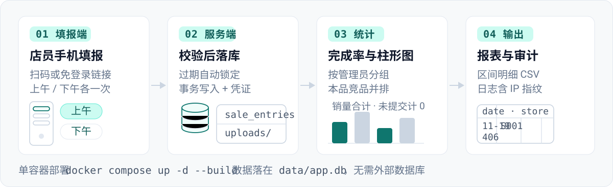
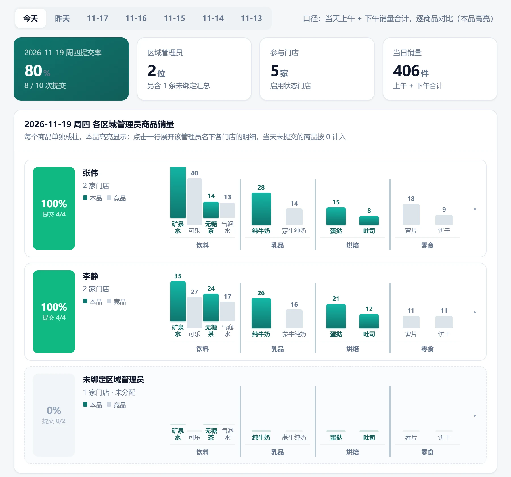
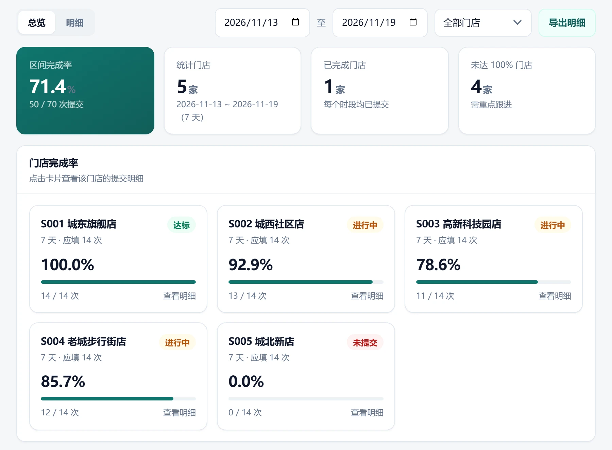
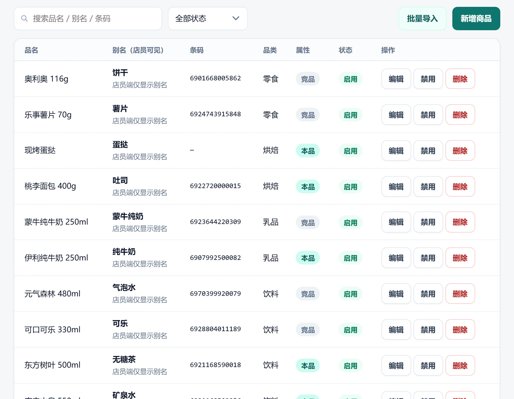
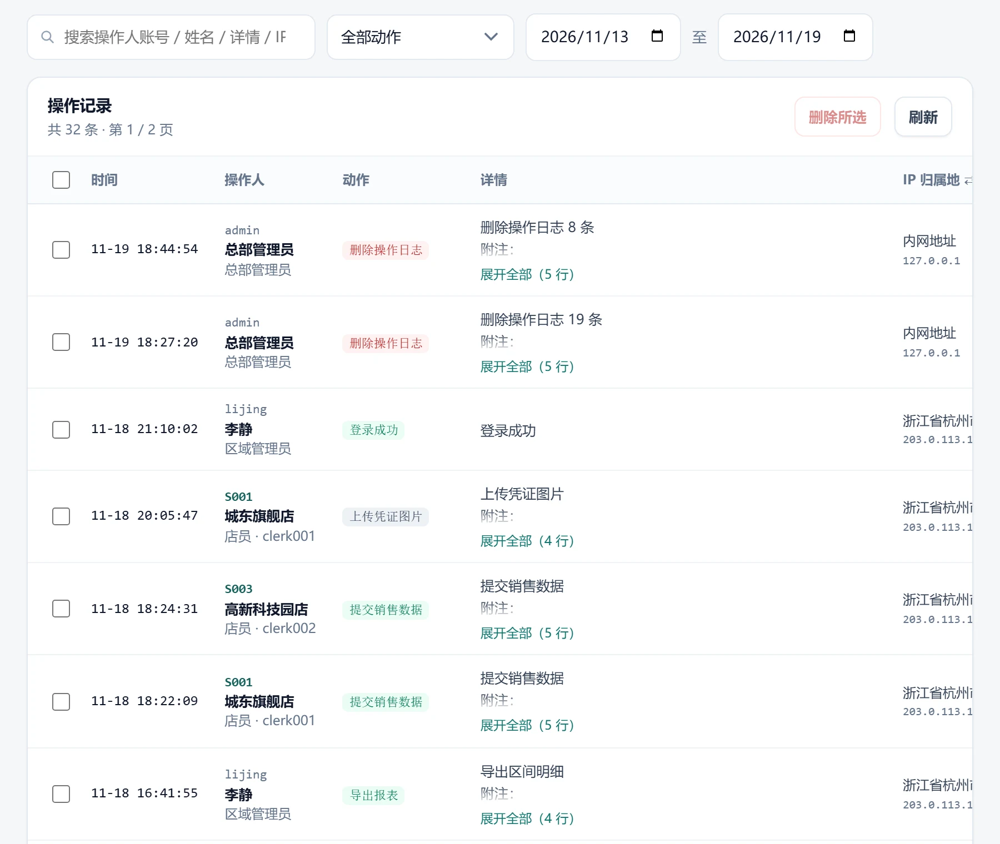
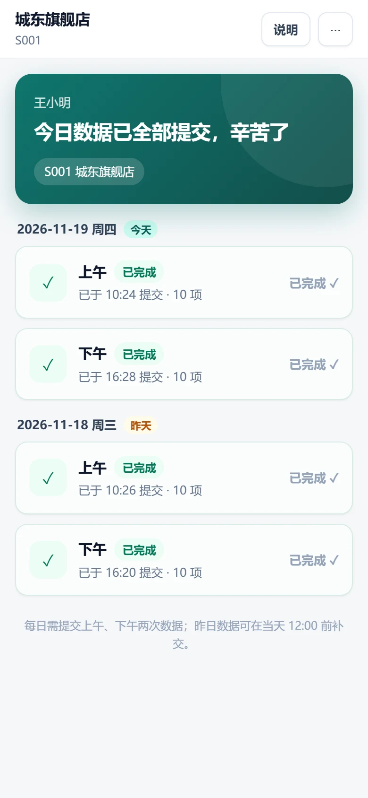

<div align="center">

<h1>店销日集</h1>

<p><b>门店销售日报的收集与统计系统</b></p>

<p>店员用手机按引导逐条录入当日销量，总部与区域管理员在后台看完成率、品类对比和操作日志<br>——不用再靠微信群收表格、人工汇总。</p>

<p><sub>Node.js 22 + Express · 内置 <code>node:sqlite</code> · 零前端构建 · 单容器部署</sub></p>

</div>



---

## 为什么是它

**一部手机就能用。** 门店可生成免登录链接与二维码，店员扫码即填，不用记账号密码，也不用装 App。

**零构建、零原生依赖。** Node.js 22 + Express，数据库直接用内置 `node:sqlite`，不编译任何扩展——镜像在哪台机器上都能稳定构建，改一行 CSS 刷新即可见效。

**数据隔离是默认行为。** 店员只看到「已提交 / 未提交」和商品**别名**，接口层面不回传历史数量与真实品名。

**单容器部署。** `docker compose up -d --build` 一条命令起来，所有数据落在 `data/` 挂载卷，备份就是拷一个目录。

---

## 看一眼

后台概览：按区域管理员分组，同一品类内**本品（深绿）与竞品（灰）并排对比**，最左侧是当天完成率，点击展开门店明细。



**数据报表** — 区间完成率卡片，逐门店展开提交明细。



**商品档案** — 品名 / 别名 / 条码 / 品类 / 本品或竞品；别名是店员端唯一可见的字段。



**操作日志** — IP 归属地 + 设备指纹，可勾选批量删除；连「删除日志」这个动作本身也会留痕。



<p align="center">

<br><sub><b>店员端</b> — 扫码进入无需登录，只看本店两个时段状态</sub>
</p>

---

## 快速开始

```bash
git clone https://github.com/Mitchll1214/store-sales-daybook.git && cd store-sales-daybook

cp .env.example .env          # 按需改端口、对外地址、初始管理员密码
docker compose up -d --build

docker compose logs -f daybook   # 首次启动打印初始管理员账号与密码
```

打开 `http://<服务器IP>:3000` 登录后台。

> 未配置 `INIT_ADMIN_PASSWORD` 时密码随机生成，同时写入 `data/initial-admin-password.txt`，登录后请立即修改。

本地不使用 Docker：

```bash
npm install
npm run dev      # node --experimental-sqlite --watch server.js
npm test         # 端到端冒烟：真实启动 HTTP 服务跑完整业务链路
```

> Node 22.x 需要 `--experimental-sqlite`（npm 脚本已内置该参数，直接 `npm start` / `npm run dev` 即可）。

---

## 上手路径

第一次用，按这个顺序走一遍就能跑通：

1. **建门店** — 后台「门店」里单条新增，或用批量粘贴一次导入（每行「编码 + 名称」，制表符、空格、逗号都认）。
2. **建商品** — 「商品档案」里维护品名、别名、条码、品类与属性；不想一个个录就用批量导入。
3. **发链接** — 门店列表里复制免登录链接或下载二维码，发给店长或店员。
4. **店员填报** — 店员扫码进入，按引导逐条录入上午、下午两班销量，可拍照留凭证后提交。
5. **看结果** — 「概览」看各区域管理员的品类柱形图与完成率，「报表」看区间明细并导出 CSV。

---

## 角色与权限

| 角色 | 能做什么 |
| --- | --- |
| **店员** `clerk` | 只看本门店今日/昨日两个时段是否已提交；引导式逐条填报，只显示商品**别名**；昨日数据在次日 12:00 前可补交 |
| **区域管理员** `region_admin` | 与总部相同的报表视角，但数据限于被授权门店（建号时直接勾选门店，不经过「区域」这一层）；可查看所辖门店店员与免登录链接、二维码；**不可**修改门店、不可看操作日志 |
| **总部管理员** `admin` | 全部门店、商品、账号的增删改（商品删除会连带清除其销售明细与门店关联）；概览品类柱形图；完成率卡片 → 提交详情；区间明细与 CSV 导出；操作日志（IP 归属地 + 设备指纹），可勾选删除记录 |

后台页面按角色自动裁剪导航：区域管理员看不到「操作日志」，也拿不到对应接口。

---

## 核心规则

**每日两个时段。** `am` 上午、`pm` 下午。当日两个时段在 24 点前都可填报；**昨日**仅在当日 12:00 前可补交，逾期锁定。

**商品关联。** 门店未选择关联商品时，默认关联**全部启用**商品；选择后只处理关联商品。商品禁用后不参与展示与统计。

**删除商品。** 总部管理员可删除商品，删除前确认框会写明将连带清除的销售明细与门店关联条数；确认后在一个事务里删除该商品的**销售明细、门店关联与档案**，相关报表口径随之变化，操作日志保留影响面。

**商品档案两个维度。** 「品类」可直接选已有或输入新品类（留空归入「未分类」），「属性」为**本品 / 竞品**。批量导入按「品名、别名、条码、品类、属性」解析。

**概览口径。** 按区域管理员分组展示柱形图：每组是该管理员所辖门店当天上午 + 下午销量逐商品展开，同一品类内本品（高亮）与竞品并排对比；品类区块按品类数量等分整行，商品多寡不影响整体节奏；当天未提交的商品按 0 计入；每组最左侧为当天完成率，点击展开门店明细。未被任何启用区域管理员管辖的门店，单独汇总为「未绑定」一条。

**免登录门店链接。** 新建门店自动生成 token，门店列表可复制链接、显示二维码（链接携带门店编码与名称便于区分）、开关可用性、重置 token。可用性开关默认打开。

**设备指纹稳定。** 指纹基于归一化 UA（剥离微信 WebView 的 `NetType/WIFI`、`NetType/4G` 等网络标记与版本号）加屏幕、时区、语言、平台等固有特征，因此**换 IP、切 WiFi/4G/5G 时指纹不变**。

**登录保护。** 同一 IP + 账号在 10 分钟内失败 6 次即临时限制，并被记入操作日志。

**操作日志。** 账号创建、改密、删除图片、免登录登录、导出、IP 库更新等全量记录，含操作人、IP、ip2region 归属地、设备指纹与网络类型。操作人按操作类型区分：**账号操作**（总部 / 区域管理员）显示「账号 + 姓名」，**门店操作**（店员账号提交、免登录链接进入）显示「门店编码 + 门店名称」。搜索框支持按操作人账号 / 姓名 / 门店编码 / 门店名称 / 详情 / IP / 设备指纹模糊匹配。总部管理员可勾选当前页记录批量删除（单次上限 200 条），**删除动作本身也会留下一条「删除操作日志」记录**，内含被删记录的 id、动作与操作人摘要。

---

## 配置

### 环境变量

| 变量 | 默认 | 说明 |
| --- | --- | --- |
| `APP_PORT` | `3000` | 宿主机映射端口（仅 compose 使用） |
| `PUBLIC_BASE_URL` | 空 | 对外访问根地址，如 `https://sales.example.com`。生成免登录链接与二维码时使用；留空则按请求 Host 推导，反向代理场景建议显式设置 |
| `APP_TZ_OFFSET` | `8` | 业务时区相对 UTC 的小时偏移（北京时间） |
| `SESSION_DAYS` | `14` | 登录会话有效天数 |
| `COOKIE_SECURE` | `0` | HTTPS 部署设为 `1`，会话 Cookie 加 `Secure` |
| `INIT_ADMIN_USERNAME` | `admin` | 内置超级管理员的账号名 |
| `INIT_ADMIN_PASSWORD` | 空 | 配置后**以环境变量为唯一来源**：每次启动校验并同步，系统内（改密页 / 后台重置）不允许修改；留空则首次启动随机生成并写入 `data/initial-admin-password.txt`，此时可自行改密 |
| `DATA_DIR` | `./data` | 宿主机数据目录，映射到容器 `/app/data` |
| `DB_PATH` | 空 | 覆盖 SQLite 文件路径（默认 `$DATA_DIR/app.db`） |
| `IPDB_IMAGE_FILE` | 空 | 覆盖镜像内置 IP 库路径（默认 `/app/vendor/ip2region_v4.xdb`） |

### 数据与备份

所有持久化数据都在数据卷内：

```
data/
├── app.db                        # SQLite（WAL 模式）
├── app.db-wal / app.db-shm
├── uploads/                      # 销售凭证图片（单张上限 5MB）
├── ipdb/                         # 后台「更新 IP 库」下载的版本（优先于镜像内置）
└── initial-admin-password.txt    # 仅随机生成初始密码时存在
```

备份只需停容器后拷贝整个 `data/`：

```bash
docker compose stop daybook
tar czf backup-$(date +%F).tar.gz data/
docker compose start daybook
```

热备也可用 `sqlite3 data/app.db ".backup backup.db"`。

### 升级与更新

`data/` 是唯一的持久化位置，容器本身可以随时重建：

```bash
docker compose up -d --build      # 正常升级：重建镜像，数据卷原样保留
```

`--build` 只重建镜像，不会碰宿主机上的 `data/`。如果升级后数据看起来「没了」，按下面顺序排查，而不是急着重灌：

1. **看启动日志第一行** `[db] 数据库：/app/data/app.db（已存在 / 新建）`。
   显示「新建」说明读到的不是原来那个库——多半是数据卷没挂上、`DATA_DIR` 被改过，或换了工作目录，数据其实还在旧路径。
2. `docker compose config` 确认 `volumes` 里 `data` 的宿主机路径与 `DATA_DIR` 一致。
3. 宿主机上 `ls -la data/` 是否还有 `app.db`、`uploads/`。

**不要用「解压压缩包覆盖部署目录」的方式更新。** 历史发布包曾把 `data/app.db`、`data/uploads/`、`.env` 一起打进去，解压时旧库会直接覆盖线上库——这是真实发生过的数据丢失原因。`data/`、`.env` 已同时加入 `.gitignore` 与 `.dockerignore`，`.zip`/`.tar.gz` 也不再入库，但升级仍应走 `git pull` + `docker compose up -d --build`。

### IP 归属地库

镜像构建时由 `scripts/fetch-ipdb.js` 从 ip2region 上游下载 v4 xdb 到 `/app/vendor`；**网络不可用时自动回退** npm 包内置版本，因此离线也能构建。运行期在「操作日志 → IP 库」可：

- **校验更新**：只查上游版本，不下载
- **更新 IP 库**：下载最新 xdb，校验可解析后热替换，无需重启

本地不使用 Docker 时，`npm run fetch:ipdb` 会生成同样的 `vendor/`。

### 反向代理（可选）

```nginx
server {
  listen 443 ssl;
  server_name sales.example.com;

  location / {
    proxy_pass http://127.0.0.1:3000;
    proxy_set_header Host $host;
    proxy_set_header X-Forwarded-For $proxy_add_x_forwarded_for;
    proxy_set_header X-Forwarded-Proto $scheme;
    client_max_body_size 6m;   # 凭证图片上限 5MB
  }
}
```

配合 `.env` 设置 `PUBLIC_BASE_URL=https://sales.example.com`、`COOKIE_SECURE=1`。

### 忘记管理员密码

内置管理员配置了 `INIT_ADMIN_PASSWORD` 时，改环境变量并重启即可（以环境变量为唯一来源）。其他情况用命令行重置：

```bash
node --experimental-sqlite scripts/reset-password.js --user admin          # 随机生成新密码
node --experimental-sqlite scripts/reset-password.js --user admin --password 新密码 --unlock
```

重置会清除该账号的全部会话并写入操作日志。容器内执行：

```bash
docker compose exec daybook node --experimental-sqlite scripts/reset-password.js --user admin
```

---

## 项目结构

```
server.js                     # 应用装配、页面路由、/s/:token 免登录入口
src/
├── db.js                     # schema、迁移、初始化管理员
├── sqlite.js                 # node:sqlite 薄封装（事务 / 命名参数）
├── auth.js                   # 会话、RBAC、可见门店范围
├── security.js               # 密码哈希、登录限流
├── net.js                    # 客户端 IP、UA 归一化、设备指纹
├── audit.js                  # 操作日志写入与查询
├── ipdb.js                   # ip2region 解析、版本校验与热更新
├── report.js                 # 概览柱形图 / 单日总览 / 门店完成率 / 明细
├── env.js                    # 本地运行时加载 .env（与 compose 行为一致）
├── util.js                   # 时区、日期、时段状态等公共工具
└── routes/                   # auth stores catalog users sales reports logs
public/                       # login / clerk（店员）/ admin（后台）/ password，无构建步骤
scripts/
├── fetch-ipdb.js             # 镜像构建期预置 IP 库
├── docker-entrypoint.sh      # 容器入口：修正数据卷属主后降权到 node 启动
└── reset-password.js         # 命令行重置密码
test/smoke.test.js            # 端到端冒烟（7 组：认证/门店商品/填报/免登录/报表/日志/指纹）
assets/readme/                # README 配图：数据流向 SVG 与各页面截图
```

技术栈刻意保持最小：Express 4 路由 + 原生 HTML/CSS/JS 前端 + `node:sqlite`，没有打包器、ORM 和前端框架。排查问题时不需要先读懂构建产物。

静态资源以协商缓存下发（`Cache-Control: no-cache` + ETag），文件名没有内容指纹也不会出现「新页面 + 旧样式」的错配。

## 接口速览

路径均为相对挂载前缀的完整写法，例如认证组的 `POST /login` 实际是 `POST /api/auth/login`。

| 挂载前缀 | 接口 |
| --- | --- |
| `/api/auth` | `GET /bootstrap`、`POST /login`、`POST /logout`、`GET /me`、`POST /password` |
| `/api/stores` | `GET /`、`POST /`、`POST /batch`（批量粘贴编码+名称）、`GET/PUT /:id`、`PUT /:id/products`、`PATCH /:id/auto-login`、`POST /:id/rotate-token`、`GET /:id/qrcode` |
| `/api/products` | `GET /`、`POST /`、`POST /batch`、`PUT/DELETE /:id` |
| `/api/users` | `GET /`、`POST /`、`GET /options`、`PUT/DELETE /:id`、`POST /:id/reset-password` |
| `/api/sales` | `GET /home`、`GET /session`、`PUT /entry`、`POST /fill-zero`、`POST /submit`、`GET/POST /images`、`GET /images/:id/file`、`DELETE /images/:id` |
| `/api/reports` | `GET /manager-day`（概览柱形图）、`GET /options`、`GET /recent`（7 日完成率）、`GET /day`（单日逐门店）、`GET /stores`（区间完成率）、`GET /detail`（按日期折叠）、`GET /export`（CSV） |
| `/api/logs` | `GET /`、`POST /delete`（勾选删除，删除动作本身写审计）、`GET /ipdb`、`POST /ipdb/check`、`POST /ipdb/update` |
| `/s/:token` | `GET /s/:token?c=<门店编码>&n=<门店名称>`，免登录入口（不在 `/api` 下） |

页面入口：`/login`、`/clerk`（店员移动端）、`/admin`（后台）、`/password`、`/healthz`（健康检查，compose healthcheck 使用）。
